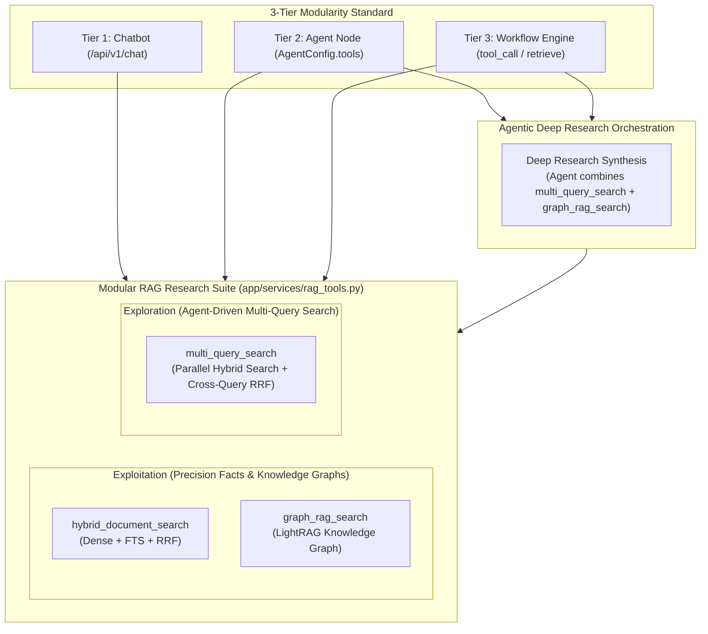
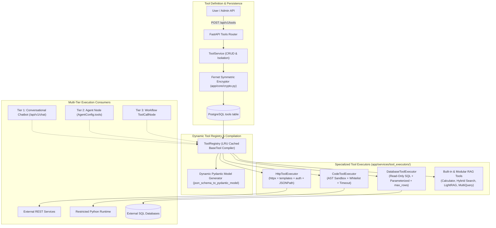

# Base Agent — Architecture & Agent Design

This document serves as the comprehensive architectural specification for **Base Agent**, detailing the conversational agent implementation, persistence layer, LLM provider integration, repository structure, and the **Agent Builder & Dynamic Workflow Engine** platform (Phases 1 & 2).

## Verified execution scope — 2026-11-01

The current supported capabilities are exposed by `GET /api/v1/workflows/capabilities`. See [audit remediation status](AUDIT_REMEDIATION_2026-11-01.md) for implementation, verification, migration requirements, and remaining work.

- Eight node types execute today. `parallel`, `subgraph`, static fan-out, and JSONPath routing are rejected before saving/running; their schemas reserve future features.
- Runs use internal `workflow:` checkpoint identities and immutable graph snapshots. Chat cannot use this reserved namespace. Approval payloads are persisted; deadlines are checked on resume. Legacy paused runs without snapshots must be restarted.
- Agent tools execute in a bounded model/tool loop. Structured JSON and guardrail output checks run before protected SSE responses are emitted; these responses buffer the final answer. Unsupported provider, memory, fusion, and tool-override settings fail explicitly.
- Knowledge ingestion, storage, and retrieval support both **User Global Scope** and **Thread Scoped Isolation**. Documents can be uploaded globally or scoped to a conversation thread (`threads/{thread_id}/`). Retrieval employs dual-layer scoping (thread documents + user global documents fallback) with strict cross-thread isolation. Knowledge attaches to retrieve nodes and is available to agent models via modular RAG research tools (`hybrid_document_search`, `graph_rag_search`, `multi_query_search`) with available document inventory injected into prompt context. Upload `index_graph=true` to request LightRAG indexing, with provider readiness exposed in document details.
- Code runs in a killable child process with a server-controlled module policy. This is **trusted-code execution**, not an operating-system sandbox for hostile code.
- Run tests offline with `pytest`. Service-backed tests require `pytest --run-integration` and a disposable `TEST_DATABASE_URL`. Tests never initialize the configured application database implicitly.

---

## 1. Repository & Codebase Structure

The project follows production-grade FastAPI and LangGraph modular conventions:

```text
Base-Agent/
├── pyproject.toml              # Project dependencies, build system (uv), pytest configuration
├── uv.lock                     # Deterministic dependency lockfile
├── .python-version             # Python version pin (3.12)
├── .env.example                # Documented environment variables template
├── .env                        # Local secret configurations (git-ignored)
├── Dockerfile                  # Production multi-stage Docker build
├── docker-compose.yml          # Multi-container orchestration (api + taskiq worker)
├── docker-compose.override.yml # Local development overrides (hot-reloading & mounts)
├── .dockerignore               # Docker build exclusions
├── alembic.ini                 # Alembic migration configuration
├── README.md                   # Project overview, getting started, roadmap
├── AGENTS.md                   # System architecture and agent design specifications
├── TODO.md                     # Roadmap enhancements & observability items
├── Vision_and_Roadmap.md       # Long-term vision and phased milestone specification
├── main.py                     # Root development runner (python main.py / uvicorn)
├── alembic/                    # Alembic async migration environment
│   ├── env.py                  # Async migration runner with psycopg3 & model inclusion filters
│   ├── script.py.mako          # Migration template with pgvector support
│   └── versions/               # Versioned migration revision scripts
├── app/
│   ├── __init__.py             # Package init & WindowsSelectorEventLoopPolicy setup
│   ├── main.py                 # FastAPI application factory, lifespan, CORS, rate limiting & root route
│   ├── core/                   # Infrastructure & singleton configurations
│   │   ├── __init__.py         # Core exports
│   │   ├── config.py           # Pydantic-settings & postgres environment sync
│   │   ├── database.py         # Async SQLAlchemy engine, session dependency & programmatic migrations
│   │   ├── auth.py             # Swappable UserContext, get_current_user & require_admin
│   │   ├── rate_limit.py       # slowapi Limiter configuration
│   │   ├── crypto.py           # Symmetric Fernet encryption & secret masking
│   │   ├── taskiq.py           # Taskiq PostgreSQL broker & lifecycle hooks
│   │   ├── llm.py              # DeepSeek LLM configuration, model registry & client factory
│   │   ├── embedding.py        # Decoupled OpenAI embedding factory (1536 dims)
│   │   ├── rag_config.py       # Precision vs Recall presets & RRF configuration
│   │   └── rag/                # Pluggable KnowledgeProvider framework
│   │       ├── protocols.py    # KnowledgeProvider protocol & data contracts
│   │       ├── workspace.py    # Multi-tenant workspace isolation (user, thread, global)
│   │       ├── registry.py     # Provider registry & decorator (@register_provider)
│   │       ├── factory.py      # Workspace-scoped cached provider factory with locks
│   │       └── providers/
│   │           ├── hybrid.py   # PGVector HNSW + PostgreSQL FTS + RRF provider
│   │           └── lightrag_provider.py # LightRAG + PGTableGraphStorage provider
│   ├── api/                    # HTTP presentation layer
│   │   ├── __init__.py
│   │   └── v1/
│   │       ├── __init__.py
│   │       ├── router.py       # API v1 aggregator router
│   │       └── endpoints/
│   │           ├── __init__.py
│   │           ├── health.py   # Health & liveness probes (/health, /ping)
│   │           ├── chat.py     # Conversation turns, streaming (SSE), & memory deletion
│   │           ├── documents.py# Document upload, search, and cascade delete
│   │           ├── storage.py  # Admin-only raw Cloudflare R2 object storage operations
│   │           ├── agents.py   # Agent Builder CRUD, clone & promotion endpoints
│   │           ├── structured_schemas.py # JSON Schema registration & validation endpoints
│   │           ├── workflows.py# Dynamic Workflow Engine CRUD, compilation & execution endpoints
│   │           └── tools.py    # Dynamic Tool CRUD, test-execution & system tool listing
│   ├── models/                 # Database persistence models
│   │   ├── __init__.py
│   │   ├── base.py             # Declarative Base & UTC TimestampMixin
│   │   ├── user.py             # User model (root user auto-seeded)
│   │   ├── thread.py           # Thread & ThreadAsset models
│   │   ├── document.py         # Document & DocumentChunk persistence models
│   │   ├── agent.py            # Agent persistence model with JSONB configuration
│   │   ├── structured_schema.py# Structured JSON schema definition model
│   │   ├── workflow.py         # Workflow & WorkflowRun state persistence models
│   │   └── tool.py             # Dynamic Tool model with JSONB config and input schema
│   ├── schemas/                # Request & response Pydantic contracts
│   │   ├── __init__.py
│   │   ├── health.py           # Health response models
│   │   ├── chat.py             # ChatRequest, ChatResponse, StreamEvent, ThreadAssetItem
│   │   ├── storage.py          # StorageObjectListResponse, PresignedUrlRequest
│   │   ├── document.py         # DocumentUploadResponse, RAGSearchRequest/Response
│   │   ├── agent.py            # AgentConfig, AgentCreate, AgentUpdate, AgentResponse
│   │   ├── structured_schema.py# StructuredSchemaCreate, StructuredSchemaResponse
│   │   ├── workflow.py         # Discriminated WorkflowNode, WorkflowEdge, execution contracts
│   │   └── tool.py             # Discriminated tool configurations, schemas, and execution payloads
│   ├── services/               # Business logic & agent workflows
│   │   ├── __init__.py
│   │   ├── agent.py            # LangGraph agent topology (retrieve -> chat) & state schema
│   │   ├── agent_service.py    # Agent CRUD, cloning, default resolution & LRU config cache
│   │   ├── schema_service.py   # Structured JSON Schema validation and persistence
│   │   ├── workflow_service.py # Multi-tenant workflow persistence, run lifecycle & execution
│   │   ├── workflow/           # Declarative Workflow Engine & Graph Compiler
│   │   │   ├── state.py        # WorkflowState, template interpolation & safe AST evaluator
│   │   │   ├── validator.py    # Topological validation (START/END connectivity, cycles)
│   │   │   ├── compiler.py     # StateGraph compiler (JSON -> LangGraph StateGraph)
│   │   │   ├── middleware/     # Curated middleware pipeline (ModelRetry, ModelFallback)
│   │   │   └── nodes/          # Node builders (chat, retrieve, conditional, code, human, tool)
│   │   ├── tool_service.py     # Dynamic tool CRUD, secret masking & test execution
│   │   ├── tool_registry.py    # Dynamic tool compiler (BaseTool + runtime Pydantic schema) & cache
│   │   ├── tool_executors/     # Specialized tool execution engines
│   │   │   ├── __init__.py     # Executor exports
│   │   │   ├── http_executor.py# Async httpx client with template interpolation & auth
│   │   │   ├── code_executor.py# AST-sandboxed Python executor with timeout & whitelist
│   │   │   └── database_executor.py # Read-only parameterized SQL query runner
│   │   ├── memory.py           # PostgreSQL checkpointer service (AsyncPostgresSaver)
│   │   ├── thread_service.py   # Thread persistence, root user, and asset management
│   │   ├── tools.py            # LangChain agent tool factory & backwards-compatible re-exports
│   │   ├── rag_tools.py        # Modular RAG research tools (Exploitation & Exploration)
│   │   ├── multi_query.py      # LLM query expansion & parallel cross-query RRF fusion
│   │   ├── document_loader.py  # Canonical Microsoft MarkItDown parser
│   │   ├── document_processor.py # Asynchronous RAG ingestion pipeline (BackgroundTasks / Taskiq)
│   │   ├── text_splitter.py    # Structure-aware token chunking (tiktoken cl100k_base)
│   │   ├── vector_store.py     # PGVector HNSW vector store service
│   │   ├── retriever.py        # Hybrid Search (Dense + FTS + RRF)
│   │   └── r2_storage.py       # Cloudflare R2 / S3 object storage service
│   └── tasks/                  # Taskiq asynchronous distributed worker tasks
│       ├── __init__.py
│       └── document_tasks.py   # process_document_task worker task
├── scripts/
│   ├── test_rag_live.py             # Interactive script testing live RAG + PGVector + FTS + RRF
│   ├── test_deepseek_live.py        # Interactive script testing live DeepSeek + PostgreSQL turns
│   ├── test_deepseek_stream_live.py # Interactive script testing live DeepSeek SSE streaming
│   ├── test_lightrag_live.py        # Interactive script testing live LightRAG + PGTableGraphStorage
│   ├── test_taskiq_live.py          # Interactive script testing live Taskiq dispatch and PG queue
│   ├── test_workflow_live.py        # Interactive script testing live Workflow Engine + Graph Compiler
│   ├── test_multi_agent_structured_workflow.py # Interactive multi-agent advisory council workflow
│   └── test_rag_research_tools_live.py # Interactive live Modular RAG Research Tool Suite verification
└── tests/
    ├── __init__.py
    ├── conftest.py             # Pytest session setup & database table auto-initialization
    ├── test_api.py             # API route tests (health, ping, chat, multimodal images)
    ├── test_auth.py            # Authentication, UserContext, and tenant isolation tests
    ├── test_storage_api.py     # Object storage endpoint tests
    ├── test_config.py          # Settings validation & URL normalization tests
    ├── test_agent.py           # Multi-turn memory & thread isolation tests
    ├── test_agents.py          # AgentConfig validation, Agent CRUD, cloning, LRU cache & isolation
    ├── test_structured_schemas.py # JSON Schema registration & validation endpoints
    ├── test_llm.py             # DeepSeek model registry & alias resolution tests
    ├── test_document_loader.py # MarkItDown parser tests
    ├── test_text_splitter.py   # Token chunking & header tracking tests
    ├── test_embedding.py       # Embedding factory tests
    ├── test_rate_limit.py      # slowapi rate limiter tests
    ├── test_retriever.py       # RRF fusion logic tests
    ├── test_documents_api.py   # Document upload, search, and delete endpoint tests
    ├── test_rag_agent.py       # RAG-augmented agent execution and streaming tests
    ├── test_rag_providers.py   # Pluggable RAG framework and provider tests
    ├── test_rag_tools.py       # Modular RAG research tools unit and integration tests
    ├── test_tools_api.py       # Tool Builder platform, executors, CRUD & workflow execution tests
    ├── test_taskiq.py          # Taskiq task queue and broker lifecycle tests
    ├── test_workflow_compiler.py# Workflow topological validation & compiler tests
    ├── test_workflow_nodes.py  # Node builder unit tests (code sandboxing, chat, retrieval)
    └── test_workflows_api.py   # Workflow CRUD, execution & multi-tenant isolation tests
```

---

## 2. Conversational Agent & RAG Topology

### Overview
The default agent is a stateful **LangGraph** workflow that combines conversation turn processing, persistent short-term PostgreSQL checkpointing, dynamic agent resolution (Phase 1), and dynamic knowledge retrieval from uploaded user documents.

### State Schema

```python
class AgentState(TypedDict, total=False):
    messages: Annotated[Sequence[BaseMessage], add_messages]
    user_id: str
    thread_id: str
    rag_context: str | None
    rag_sources: list[dict[str, Any]]
    thread_assets: list[dict[str, Any]]
    thread_assets_context: str | None
    knowledge_base_context: str | None
```

- **`messages`**: Chronological sequence of messages (`HumanMessage`, `AIMessage`, `SystemMessage`), supporting multimodal text and image content blocks.
- **`user_id`**: Identifier of the current user (scopes document retrieval, thread ownership, and memory; defaults to `"root"`).
- **`thread_id`**: Unique conversation session identifier ensuring memory and document isolation.
- **`rag_context`**: Formatted passage text retrieved from PostgreSQL for the current turn.
- **`rag_sources`**: Structured metadata for retrieved document chunks (filenames, sections, citations).
- **`thread_assets`**: Structured records of uploaded media files (images, documents) associated with the thread, populated with fresh SigV4 presigned download URLs.
- **`thread_assets_context`**: Formatted prompt context listing all uploaded thread assets and presigned URLs for LLM awareness.
- **`knowledge_base_context`**: Formatted prompt context listing available indexed documents in user's knowledge base, distinguishing `[Thread Document]` from `[Global Document]`.

### Graph Topology

```
START ──► [retrieve_node] ──► [chat_node] ──► END
```

- **`retrieve_node`**:
  1. Resolves thread assets from PostgreSQL and generates fresh presigned download URLs for all uploaded images and documents.
  2. Formats `thread_assets_context` for system prompt injection.
  3. Queries user knowledge base inventory via `get_user_knowledge_base_context(user_id, thread_id)` and attaches `knowledge_base_context` for LLM situational awareness.
  4. Checks `configurable.use_rag`. When false, passes through immediately with thread assets and KB context.
  5. Extracts the user's latest message text (handling both raw strings and multimodal content blocks).
  6. Executes dual-layer hybrid retrieval (dense + sparse + RRF) or LightRAG knowledge graph traversal scoped to `thread_workspace(user_id, thread_id)` (with user global fallback).
  7. Returns `rag_context`, `rag_sources`, `thread_assets`, `thread_assets_context`, and `knowledge_base_context`.
- **`chat_node`**:
  1. Reads conversation history from the checkpointer.
  2. Injects system instructions combining dynamic persona from the resolved agent config, knowledge grounding (if `rag_context` is present), thread asset context, and knowledge base document inventory.
  3. Formats human input into OpenAI-compatible multimodal vision blocks (`image_url`) if image URLs or R2 keys are provided.
  4. Resolves and binds dynamic agent tools as well as pre-bound RAG research tools (`hybrid_document_search`, `graph_rag_search`, `multi_query_search` capturing `user_id` and `thread_id` in closures).
  5. Invokes the bounded model/tool execution loop (`invoke_agent`) asynchronously (or streams via SSE) with model overrides and max token settings.
  6. Appends the model response to state.

---

## 3. Persistent Memory Architecture

### Single Connection Driver Strategy (`psycopg3`)
To avoid running duplicate connection pools and mismatched database drivers, both **SQLAlchemy** and **LangGraph** share the exact same `psycopg3` driver ecosystem:
- **Application ORM**: `postgresql+psycopg://` via async SQLAlchemy engine.
- **LangGraph Checkpointer**: `AsyncPostgresSaver` backed by a dedicated `psycopg_pool.AsyncConnectionPool`.

### PostgreSQL Checkpointer (`AsyncPostgresSaver`)
- **Tables**: `checkpoints`, `checkpoint_blobs`, `checkpoint_writes` (auto-created at startup via `setup_checkpointer()`).
- **Isolation**: Each conversation turn or workflow execution run is isolated by `configurable = {"thread_id": "...", "user_id": "..."}`.
- **Operations Supported**:
  - `execute_agent()` / `execute_workflow()`: Resumes state, executes nodes, writes new checkpoint.
  - `get_thread_messages()`: Fetches full message history directly from storage.
  - `delete_thread_memory()`: Drops all checkpoints for a thread upon user request.
  - `delete_thread_cascade(db, thread_id, user_id)`: Atomic cascade purges all thread-scoped resources:
    1. Vector chunks in PGVector (`delete_documents_by_metadata("document_id", ...)`)
    2. LightRAG thread workspace (`thread_workspace(user_id, thread_id)`)
    3. R2 raw files for thread documents and thread media assets
    4. LangGraph checkpoint memory records
    5. Thread database record (with SQL `ON DELETE CASCADE` to child tables)

---

## 4. LLM Provider Design: DeepSeek

The application connects to **DeepSeek** via its OpenAI-compatible endpoint:

- **Base URL (OpenAI format)**: `https://api.deepseek.com`
- **Base URL (Anthropic format)**: `https://api.deepseek.com/anthropic`

### Supported Models

| Shorthand / API Identifier | Underlying Model Version | Context | Max Output | Vision | Concurrency | Primary Use Case |
| -------------------------- | ------------------------ | ------- | ---------- | ------ | ----------- | ---------------- |
| **`deepseek-flash`** (Default) | `DeepSeek-V4.1-Flash-1017` | 1M | 384K | Yes | 2500 | Fast, high-throughput conversational chatbot & workflows |
| **`deepseek-v4-pro`** | `DeepSeek-V4-Pro-0813` | 1M | 384K | No | 500 | Advanced reasoning & complex multi-step tasks |

---

## 5. Knowledge Retrieval & Pluggable RAG Architecture

Base Agent implements a modular **Pluggable RAG Architecture** (`app/core/rag/`) that allows the conversational agent and custom workflow nodes to bind against standardized knowledge retrieval and graph reasoning backends:

```text
app/core/rag/
├── protocols.py            # KnowledgeProvider Protocol + standardized contracts
├── registry.py             # PROVIDER_REGISTRY + @register_provider decorator
├── factory.py              # Workspace-scoped cached provider factory with locks
├── workspace.py            # Multi-tenant workspace isolation (user, thread, global)
└── providers/
    ├── hybrid.py           # Dense PGVector HNSW + Sparse PostgreSQL FTS + RRF
    └── lightrag_provider.py # LightRAG + PGTableGraphStorage knowledge graph provider
```

### 1. Hybrid Search Provider (`hybrid`)
Combines dense semantic vector search and sparse keyword search:
- **Dense Semantic Search**: OpenAI `text-embedding-3-small` (1536-dimensional embeddings) with PostgreSQL HNSW cosine distance index (`vector_cosine_ops`).
- **Sparse Keyword Search**: PostgreSQL Full-Text Search with GIN index on `to_tsvector('english', document)` and `plainto_tsquery` / `ts_rank_cd`.
- **Reciprocal Rank Fusion (RRF)**:
  $$\text{RRF}(d) = \frac{w_{\text{dense}}}{k + \text{rank}_{\text{dense}}} + \frac{w_{\text{sparse}}}{k + \text{rank}_{\text{sparse}}}$$
- **Presets**: `high_precision` (200 tokens), `balanced` (500 tokens), `high_recall` (1000 tokens).

### 2. Knowledge Graph Provider (`lightrag`)
For high-precision factual retrieval and multi-hop relationship reasoning, Base Agent integrates **LightRAG** with native PostgreSQL tables:
- **Storage Backend (`PGTableGraphStorage`)**: Plain indexed PostgreSQL tables (`lightrag_graph_nodes`, `lightrag_graph_edges`, `lightrag_doc_full`, `lightrag_doc_chunks`, `lightrag_doc_status`) with JSONB properties and B-tree indexes. Requires **zero Apache AGE extension**, enabling seamless deployment on managed cloud PostgreSQL like **Neon**.
- **Context-Only Mode (`only_need_context=True`)**: Extracts and returns graph entities, relations, and relevant chunks without triggering duplicate LLM answer generation, letting the LangGraph conversational agent own generation and streaming.
- **Modes Supported**: `mix` (integrated local + global graph reasoning), `local` (neighborhood entities), `global` (thematic relations), `hybrid`, and `naive` (pure vector).

### 3. Multi-Tenant Workspace Isolation
Tenant boundaries are enforced at the storage level using LightRAG's native `workspace` column:
- **`user_workspace(user_id)`**: Shared global knowledge base for the user (e.g. `u_root`).
- **`thread_workspace(user_id, thread_id)`**: Thread-isolated graph bucket providing session-scoped memory and zero cross-thread pollution.
- **`agent_workspace(user_id, agent_id)`**: Dedicated knowledge base for custom Agent Builder agents.
- **`global_workspace()`**: Shared cross-user knowledge base (`global_kb`).

### 4. Modular RAG Research Tool Suite (Exploitation vs Exploration)
Base Agent provides a first-class suite of research tools (`app/services/rag_tools.py`) designed for complete 3-tier modularity across Chatbot turns, Agent Builder configs, and Workflow Engine nodes:



#### Exploitation Tools (Precision Retrieval & Factual Grounding)
- **`hybrid_document_search`**: Single-query targeted retrieval using OpenAI `text-embedding-3-small` (1536 dims) + PostgreSQL Full-Text Search fused via Reciprocal Rank Fusion (`high_precision`, `balanced`, `high_recall`). Returns formatted passages with section headers and filenames.
- **`graph_rag_search`**: Navigates the LightRAG knowledge graph stored in PostgreSQL (`PGTableGraphStorage`). Supports `mix`, `local`, `global`, `hybrid`, and `naive` traversal for entity networks, multi-hop relationship reasoning, and high-level summaries.

#### Exploration Tools (Agent-Driven Multi-Perspective Discovery)
- **`multi_query_search`**: Accepts an array of complementary search queries directly from the calling agent (`queries: list[str]`). Dispatches concurrent hybrid searches across all queries (`asyncio.gather`), deduplicates documents, and fuses results using cross-query Reciprocal Rank Fusion with multi-query coverage bonuses:
  $$\text{Score}(d) = \sum_{q \in Q} \frac{1}{60 + \text{rank}(d, q)} + (\text{matched\_queries} - 1) \times 0.05$$
  Allows the agent to actively drive multi-perspective exploration without internal black-box query rewriting.

#### Agentic Deep Research Orchestration
Rather than a rigid monolithic tool, **Deep Research** is an agentic pattern orchestrated by autonomous agents and multi-agent workflows. The agent formulates an exploratory query array (`multi_query_search`), queries the relational knowledge graph (`graph_rag_search`), and synthesizes evidence into a structured research dossier.

#### 3-Tier Modularity Standard
1. **Tier 1 (Chatbot Level)**: Chat requests (`/api/v1/chat` and `/api/v1/chat/stream`) accept `retrieval_mode` (`"hybrid"`, `"lightrag"`, `"multi_query"`), seamlessly selecting the retrieval pipeline during conversation turn execution.
2. **Tier 2 (Agent Node Level)**: Custom agents in the Agent Builder platform declaratively attach research tools via `AgentConfig.tools`. `resolve_agent_tools(agent_config, user_id)` pre-binds tools to the caller's identity at runtime.
3. **Tier 3 (Workflow Engine Level)**:
   - **`ToolCallNode`**: Directly resolves and executes any RAG research tool by name (`hybrid_document_search`, `graph_rag_search`, `multi_query_search`) with argument normalization and retry backoff.
   - **`RetrieveNode`**: Configurable via `RetrieveNodeConfig.provider_name` (`"hybrid"`, `"lightrag"`, `"multi_query"`) with automatic workspace resolution (`user`, `thread`, `agent`, `global`).

---

## 6. Cloudflare R2 & Document Lifecycle Pipeline

### Ingestion Flow & Fault-Tolerant Recovery
1. **Upload**: User uploads document (`PDF`, `DOCX`, `XLSX`, `HTML`, `TXT`, `MD`) via `POST /api/v1/documents/upload`, optionally supplying a `thread_id` for conversation-isolated scoping.
2. **Object Storage**: Stored in Cloudflare R2 (S3-compatible) via async `aioboto3` under partitioned keys:
   - **Thread-scoped documents**: `documents/{user_id}/threads/{thread_id}/{doc_id}_{file_name}`
   - **Global documents**: `documents/{user_id}/global/{doc_id}_{file_name}`
   Storage operations use `tenacity` exponential backoff retries on transient network/5xx errors.
3. **Atomic Rollback**: If PostgreSQL metadata commitment fails after upload, the raw R2 object is automatically deleted to prevent orphaned files.
4. **Immediate 202 Response**: Document record is initialized with status `PARSING`, and an HTTP 202 Accepted response is returned immediately to prevent client timeouts.
5. **Asynchronous Background Processing**: Dispatched to Taskiq worker (with fallback to FastAPI `BackgroundTasks`) executing `process_document_pipeline` in an isolated database session.
6. **Parsing**: Converted to structured markdown via Microsoft **MarkItDown** (`markitdown` with `pdfminer.six` PDF dependency).
7. **Chunking**: Structure-aware splitting using `MarkdownHeaderTextSplitter` + `RecursiveCharacterTextSplitter.from_tiktoken_encoder` (`cl100k_base`), preserving section hierarchy. Chunks for thread-scoped documents are tagged with `thread_id` in chunk metadata.
8. **Embedding & Indexing**: Vectors indexed into `langchain_pg_embedding` in PostgreSQL with HNSW cosine index and PostgreSQL FTS GIN index. If `index_graph=True`, entities and relationships are indexed into LightRAG using `thread_workspace(user_id, thread_id)` for thread-scoped documents or `user_workspace(user_id)` for global documents. Status is updated to `INDEXED` or `FAILED`.
9. **Stuck-Document Advisory Lock Sweeper**: Background sweeper running every 5 minutes and on startup uses a PostgreSQL advisory lock (`pg_try_advisory_lock(847291)`) to recover documents stuck in `PARSING`. Documents are retried up to 3 times before transitioning to `FAILED` with actionable guidance for 1-click re-indexing.
10. **Cascade Delete (Atomic-Safe)**: When a document is deleted via `DELETE /api/v1/documents/{document_id}` or re-indexed via `POST /api/v1/documents/{document_id}/reindex`, the following steps execute in order:
    1. PGVector chunks purged (reversible via re-index).
    2. LightRAG knowledge graph entities purged from the corresponding workspace (best-effort, logged).
    3. R2 raw file deleted — failure raises HTTP 500 and aborts the DB delete to prevent orphan rows.
    4. Database record deleted (cascades to `document_chunks`).

---

## 7. Event Streaming Architecture (SSE & LangChain v3 Protocol)

Real-time token and reasoning event streaming over HTTP via **Server-Sent Events (SSE)** using LangGraph's native `astream_events(..., version="v3")`.

### Wire Format
- `token`: Incremental response text chunk.
- `reasoning`: Incremental reasoning delta (DeepSeek thinking mode).
- `end`: Final turn snapshot containing `response`, `agent_id`, `history_length`, and retrieved `sources` (including `view_url` and `download_url`).
- `error`: Error payload.

---

## 8. API Endpoints

### Core & Conversation (`/api/v1/chat`)
| Method | Path | Summary | Description |
| ------ | ---- | ------- | ----------- |
| `GET` | `/` | Root | Service info and API status |
| `GET` | `/api/v1/health` | Readiness Probe | Verifies PostgreSQL connectivity |
| `GET` | `/api/v1/ping` | Liveness Probe | Lightweight health check |
| `POST` | `/api/v1/chat` | Send Message | Executes a conversation turn (optional RAG, multimodal images, agent_id resolution) |
| `POST` | `/api/v1/chat/stream` | Stream Message | Streams real-time tokens & reasoning via SSE with multimodal images |
| `POST` | `/api/v1/chat/{thread_id}/assets` | Upload Asset | Uploads an image or document attachment linked to thread |
| `GET` | `/api/v1/chat/{thread_id}/assets` | List Assets | Lists uploaded images & documents in thread with fresh signed URLs |
| `GET` | `/api/v1/chat/{thread_id}/details` | Thread Details | Retrieves thread metadata, title, and active assets |
| `GET` | `/api/v1/chat/{thread_id}/history` | Get History | Retrieves full conversation history |
| `DELETE` | `/api/v1/chat/{thread_id}` | Clear Thread & Memory | Cascade deletes thread checkpoint memory, thread-scoped documents (R2/PGVector/LightRAG), and thread assets |

### Knowledge Base Management (`/api/v1/documents`)
| Method | Path | Summary | Description |
| ------ | ---- | ------- | ----------- |
| `GET` | `/api/v1/documents/stats` | KB Statistics | Aggregated document, chunk, and storage metrics |
| `GET` | `/api/v1/documents` | List Documents | Lists user's documents with search filter, pagination, and optional `thread_id` filter (`'global'` or thread UUID) |
| `POST` | `/api/v1/documents/upload` | Upload & Index | Uploads to R2, parses with MarkItDown, chunks & indexes in background (supports optional `thread_id` for thread scoping) |
| `GET` | `/api/v1/documents/{document_id}` | Document Details | Metadata, status, retry count, chunk count, `thread_id`, and presigned download URL |
| `GET` | `/api/v1/documents/{document_id}/chunks` | Inspect Chunks | Granular inspection of document text chunks & headers |
| `POST` | `/api/v1/documents/{document_id}/reindex` | Re-index Document | Re-chunks/re-indexes from R2 source with new preset and purges graph |
| `GET` | `/api/v1/documents/{document_id}/download` | View / Download Document | Streams binary from R2 with `?inline=true` browser preview support |
| `DELETE` | `/api/v1/documents/{document_id}` | Cascade Delete | Purges from R2, PGVector chunks, LightRAG graph, and database |
| `POST` | `/api/v1/documents/search` | Direct Hybrid Search | Direct Hybrid Search (Dense HNSW + FTS GIN + RRF fusion) supporting optional `thread_id` scoping |
| `POST` | `/api/v1/documents/search` | Direct Hybrid Search | Hybrid retrieval (Dense + FTS + RRF) with preset tuning |

### Object Storage Management (`/api/v1/storage` — Admin Only)
| Method | Path | Summary | Description |
| ------ | ---- | ------- | ----------- |
| `GET` | `/api/v1/storage/stats` | Storage Stats | Bucket metrics, total files, and bytes consumed (Root only) |
| `GET` | `/api/v1/storage/objects` | List Objects | Lists objects matching prefix with ETags and signed URLs (Root only) |
| `POST` | `/api/v1/storage/upload` | Direct Upload | Uploads asset under deterministic user namespace (Root only) |
| `GET` | `/api/v1/storage/objects/{key}` | Object Details | Metadata, size, content-type, and presigned URL (Root only) |
| `GET` | `/api/v1/storage/download/{key}` | Download Object | Streams binary file directly from Cloudflare R2 (Root only) |
| `POST` | `/api/v1/storage/presigned-url` | Generate Presigned URL | Generates temporary PUT (direct client upload) or GET URL (Root only) |

### Agent Management (`/api/v1/agents`)
| Method | Path | Summary | Description |
| ------ | ---- | ------- | ----------- |
| `GET` | `/api/v1/agents/default` | Default Agent | Returns or auto-provisions user's default assistant |
| `GET` | `/api/v1/agents` | List Agents | Lists user's agents with pagination and search filter |
| `POST` | `/api/v1/agents` | Create Agent | Creates a custom agent with validated configuration |
| `GET` | `/api/v1/agents/{agent_id}` | Get Agent | Retrieves agent configuration and metadata by ID |
| `PUT` | `/api/v1/agents/{agent_id}` | Update Agent | Updates agent settings, auto-incrementing its version |
| `POST` | `/api/v1/agents/{agent_id}/clone` | Clone Agent | Clones configuration into a new non-default agent instance |
| `POST` | `/api/v1/agents/{agent_id}/set-default` | Set Default | Promotes agent to user's default assistant |
| `DELETE` | `/api/v1/agents/{agent_id}` | Delete Agent | Deletes agent (deletion of default agent rejected) |

### Structured Schema Management (`/api/v1/structured-schemas`)
| Method | Path | Summary | Description |
| ------ | ---- | ------- | ----------- |
| `GET` | `/api/v1/structured-schemas` | List Schemas | Lists user's registered JSON schemas with search |
| `POST` | `/api/v1/structured-schemas` | Create Schema | Validates against Draft 2020-12 and persists schema |
| `GET` | `/api/v1/structured-schemas/{schema_id}` | Get Schema | Retrieves schema definition and metadata by ID |
| `PUT` | `/api/v1/structured-schemas/{schema_id}` | Update Schema | Updates definition, auto-incrementing schema version |
| `DELETE` | `/api/v1/structured-schemas/{schema_id}` | Delete Schema | Deletes registered schema definition |

### Workflow Engine & Execution (`/api/v1/workflows`)
| Method | Path | Summary | Description |
| ------ | ---- | ------- | ----------- |
| `POST` | `/api/v1/workflows` | Create Workflow | Registers workflow with node & edge graph after topological validation |
| `GET` | `/api/v1/workflows` | List Workflows | Lists user workflows with pagination and search |
| `GET` | `/api/v1/workflows/{workflow_id}` | Get Workflow | Retrieves graph topology, nodes, edges, and validation schemas |
| `PUT` | `/api/v1/workflows/{workflow_id}` | Update Workflow | Updates workflow graph, re-validates topology, increments version |
| `DELETE` | `/api/v1/workflows/{workflow_id}` | Delete Workflow | Cascades deletion of workflow and all execution run logs |
| `POST` | `/api/v1/workflows/validate` | Validate Graph | Dry-run topological validation of nodes and edges without saving |
| `POST` | `/api/v1/workflows/{workflow_id}/run` | Execute Workflow | Runs compiled state graph with persistent checkpointing |
| `GET` | `/api/v1/workflows/{workflow_id}/runs` | List Runs | Lists historical runs and outcomes for a workflow |
| `GET` | `/api/v1/workflows/runs/{run_id}` | Run Details | Inspects status, execution traces, node history, and error logs |
| `POST` | `/api/v1/workflows/runs/{run_id}/resume` | Resume Run | Resumes an INTERRUPTED workflow with human decision input |
| `POST` | `/api/v1/workflows/{workflow_id}/nodes/{node_id}/knowledge` | Attach Node Knowledge | Dynamically configures or overrides per-node RAG provider settings |

### Dynamic Tool Builder & Registry (`/api/v1/tools`)
| Method | Path | Summary | Description |
| ------ | ---- | ------- | ----------- |
| `POST` | `/api/v1/tools` | Create Tool | Registers custom tool (`api`, `code`, `database`) with encrypted secrets |
| `GET` | `/api/v1/tools` | List Tools | Lists tenant tools (and system tools) with search and pagination |
| `GET` | `/api/v1/tools/built-in` | List Built-in Tools | Discovers global system tools (calculator, modular RAG research suite) |
| `GET` | `/api/v1/tools/{tool_id}` | Get Tool | Retrieves tool definition with masked secret credentials |
| `PUT` | `/api/v1/tools/{tool_id}` | Update Tool | Updates configuration, re-encrypts updated secrets, increments version |
| `DELETE` | `/api/v1/tools/{tool_id}` | Delete Tool | Removes tool and purges cached instances from `ToolRegistry` |
| `POST` | `/api/v1/tools/{tool_id}/execute` | Test Execute Tool | Directly executes a tool in isolation with test arguments |

---

## 9. Authentication & Tenant Isolation

Base Agent implements a swappable authentication and multi-tenant isolation layer in [`app/core/auth.py`](app/core/auth.py):

### Identity Model (`UserContext`)
```python
class UserContext(BaseModel):
    user_id: str
    role: str = "user"  # "user" | "admin"
    email: str | None = None
```

### Dependency Injection Flow
1. **`get_current_user`**: Inspects incoming request via FastAPI dependency injection:
   - Header: `X-User-ID`
   - Role Header: `X-User-Role` (defaults to `"user"`, or `"admin"` if `user_id == "root"`)
   - Email Header: `X-User-Email`
   - Authorization Header: `Authorization: Bearer mock_<user_id>`
   - Query Parameter: `?user_id=<user_id>` (for convenient browser preview and testing)
   - Fallback Default: `"root"` (ensures seamless backward compatibility for testing and local development)
2. **`require_admin`**: Validates `current_user.is_admin`, rejecting non-admin callers with `HTTP 403 Forbidden`. Enforced on all direct R2 object storage administration routes (`/api/v1/storage/*`).
3. **Thread Ownership Enforcement**: `verify_thread_ownership(thread, user_id)` verifies that conversation threads cannot be accessed, modified, listed, or deleted by any user other than the owner or a superadmin (`root`).
4. **Document Scoping**: All document operations (`upload`, `list`, `chunks`, `reindex`, `download`, `delete`, `search`) scope queries by `document.user_id == current_user.user_id`.
5. **Agent & Workflow Scoping**: Custom agents, structured schemas, workflows, and execution runs are strictly isolated to `user_id == current_user.user_id`. Attempting to access or mutate another user's resource results in an immediate `HTTP 403 Forbidden`.

---

## 10. Asynchronous Task Queue (Taskiq + PostgreSQL)

For production background task execution (document parsing, chunking, and embedding generation), Base Agent integrates **Taskiq** (`0.12.6`) with a native PostgreSQL broker (`taskiq-pg` `0.2.0`):

```text
API Request (upload/reindex)
       │
       ▼
[Taskiq Broker] ──► Writes job to PostgreSQL `taskiq_messages` table
       │
       ▼ (Worker process polls)
[Taskiq Worker] (app.tasks.document_tasks:process_document_task)
       │
       ├── 1. Fetches raw binary stream directly from Cloudflare R2
       ├── 2. Parses to structured markdown via Microsoft MarkItDown
       ├── 3. Splits into token-aware chunks with header preservation
       ├── 4. Generates OpenAI 1536-dim embeddings
       ├── 5. Inserts vectors into PGVector HNSW and PostgreSQL FTS
       └── 6. Updates document status to INDEXED or FAILED
```

### Key Architectural Decisions:
- **Taskiq 0.12.6 Pinning**: Pinned to the 0.12.6 stable release to maintain strict compatibility with `taskiq-pg`'s serialization layer.
- **Worker Payload Optimization**: Large file payloads (up to 25 MB) are **never** passed across PostgreSQL message broker tables. Instead, tasks pass lightweight identifiers (`document_id`, `r2_key`, `user_id`, `filename`, `content_type`), and the background worker streams the raw file directly from Cloudflare R2.
- **Dual-Dispatch Fallback**: Document upload and re-index endpoints attempt `process_document_task.kiq(...)`. If the broker is uninitialized (e.g. unit tests without background broker), it automatically falls back to in-process FastAPI `BackgroundTasks`.

---

## 11. Database Migrations (Alembic)

Database schema evolution is managed via async **Alembic** (`alembic/`):

### Architecture & Isolation:
- **Migration Driver**: Uses `postgresql+psycopg://` with an async SQLAlchemy engine inside [`alembic/env.py`](alembic/env.py).
- **Target Metadata Isolation (`include_name`)**: Only tables registered in application ORM `Base.metadata` (`users`, `threads`, `thread_assets`, `documents`, `document_chunks`, `agents`, `structured_schemas`, `workflows`, `workflow_runs`) and `alembic_version` are managed by Alembic. External tables managed by other subsystems (`lightrag_*`, `checkpoint_*`, `langchain_pg_*`, `taskiq_*`) are strictly excluded from autogeneration diffs.
- **Transaction Safety**: `run_async_migrations()` executes `await connection.commit()` to ensure DDL changes are persisted cleanly on serverless PostgreSQL (Neon).
- **Programmatic Startup Migration**: [`app/core/database.py`](app/core/database.py) executes `run_migrations()` (`alembic upgrade head`) automatically inside the FastAPI `lifespan` handler before incoming requests are accepted.

---

## 12. Rate Limiting & Abuse Prevention

Base Agent incorporates endpoint-level rate limiting using **slowapi** (`app/core/rate_limit.py`):

| Endpoint | Limit | Purpose |
| -------- | ----- | ------- |
| `POST /api/v1/chat` | `30/minute` | Protects DeepSeek API quota and database checkpointer |
| `POST /api/v1/chat/stream` | `20/minute` | Governs long-lived SSE connections and token generation |
| `POST /api/v1/chat/{thread_id}/assets` | `20/minute` | Caps media uploads and R2 writes |
| `POST /api/v1/documents/upload` | `10/minute` | Restricts CPU-intensive MarkItDown parsing & embedding compute |
| `POST /api/v1/documents/search` | `60/minute` | Balances interactive search against vector index load |
| `POST /api/v1/agents` | `20/minute` | Protects agent provisioning and JSONB validation |
| `GET /api/v1/agents` | `60/minute` | Governs agent catalog queries |
| `POST /api/v1/structured-schemas` | `20/minute` | Governs JSON Schema registration |
| `POST /api/v1/workflows` | `20/minute` | Protects graph persistence and validation |
| `POST /api/v1/workflows/validate` | `30/minute` | Throttles dry-run graph topological checks |
| `POST /api/v1/workflows/{id}/run` | `20/minute` | Caps workflow execution runs and LLM fan-outs |
| `GET /api/v1/workflows` | `60/minute` | Governs workflow listings |

---

## 13. Containerization & Production Deployment (Docker)

The project includes production-hardened Docker and Docker Compose definitions:

### Multi-Stage Dockerfile (`Dockerfile`):
1. **Builder Stage**: Uses `ghcr.io/astral-sh/uv:python3.12-bookworm-slim` to compile and sync dependencies into a clean `.venv` using `uv sync --frozen --no-dev --no-install-project`.
2. **Runtime Stage**: Uses lightweight `python:3.12-slim-bookworm`, copies the virtualenv, creates an unprivileged user `appuser` (UID 10001), and exposes port 8000.
3. **Health Check**: Native `curl -f http://localhost:8000/api/v1/ping || exit 1` probe every 30s.

### Orchestration (`docker-compose.yml`):
- **`api` service**: Runs FastAPI web server (`uvicorn app.main:app --host 0.0.0.0 --port 8000`).
- **`worker` service**: Runs distributed Taskiq worker (`taskiq worker app.core.taskiq:broker app.tasks.document_tasks`).
- **`docker-compose.override.yml`**: Optional local development override mounting code into containers with hot-reload enabled.

---

## 14. Agent Builder Platform: Configurable Agents & Schemas (Phase 1)

Base Agent provides complete custom agent management:

### 1. Persistence & JSONB Storage
- **`agents` table**: Decouples relational identity (`id`, `user_id`, `name`, `is_default`, `version`) from dynamic capabilities stored in a validated JSONB `config` column.
- **Auto-Seeded Default Assistant**: Every user automatically receives a default assistant upon initial turn or query (`GET /api/v1/agents/default`), ensuring zero disruption to existing `/api/v1/chat` clients. Default agents are protected from accidental deletion.
- **Config Contract (`AgentConfig`)**: Validated via Pydantic v2:
  - `identity`: System prompt, name, avatar, locale, response format.
  - `model`: Target provider, model ID, temperature, max tokens, fallback model.
  - `providers`: List of knowledge provider attachments with weights and presets.
  - `tools`: Attached tools with approval toggles and retry settings.
  - `guardrails`: Input/output sanitization and safety filters.
  - `memory`: Context window length and summarization thresholds.
  - `advanced`: Max recursion, timeout, and retry counts.

### 2. In-Memory LRU Configuration Caching
To eliminate database overhead on every conversational turn, resolved agent configurations are cached in an in-memory LRU cache (`app/services/agent_service.py`), keyed by `(agent_id, version)`. Mutations (`PUT`, `DELETE`, `clone`) automatically invalidate stale entries.

### 3. Structured JSON Schema Registry
- **`structured_schemas` table**: Stores validated JSON schemas (JSON Schema Draft 2020-12 via `jsonschema`).
- Users can register schemas to enforce structured outputs across agent responses or workflow outputs.

---

## 15. Declarative Workflow Engine & Graph Compiler (Phase 2)

Phase 2 introduces a **production-grade declarative workflow engine** that compiles JSON graph definitions into executable LangGraph `StateGraph(WorkflowState)` state machines.

### 1. Data Models (`workflows` & `workflow_runs`)
- **`workflows` table**: Stores graph topology (`nodes` JSONB, `edges` JSONB), optional `input_schema` and `output_schema`, recursion limits (default 25), and versioning.
- **`workflow_runs` table**: Persists run status (`PENDING`, `RUNNING`, `COMPLETED`, `FAILED`, `INTERRUPTED`), input data, output data, error messages, and execution traces (`node_history`).

### 2. Node Types & Discriminated Union (`app/schemas/workflow.py`)
All nodes inherit from `BaseNodeModel` and deserialize via a discriminated union on `type`:

| Node Type | Config Schema | Runtime Behavior |
|---|---|---|
| **`start`** | `StartNodeConfig` | Entry point. Ingests inputs, validates against `input_schema`, seeds `initial_variables`. |
| **`end`** | `EndNodeConfig` | Terminal node. Validates against `output_schema`, returns `response_variable` or full state. |
| **`chat`** | `ChatNodeConfig` | LLM invocation. Renders prompts via template engine, wraps execution in `ModelRetry` and `ModelFallback` middlewares. |
| **`retrieve`** | `RetrieveNodeConfig` | Knowledge retrieval. Queries Hybrid Search (PGVector + FTS) with tenant scoping and top-$k$ slicing. |
| **`conditional`** | `ConditionalNodeConfig` | Router node. Evaluates AST expressions, variable comparisons, regex, and routes to matching branch or fallback. |
| **`code`** | `CodeNodeConfig` | Python execution. Runs code in an AST-inspected restricted sandbox with forbidden call/import guards and timeouts. |
| **`human_approval`** | `HumanApprovalNodeConfig` | HITL review. Triggers LangGraph `interrupt()`, moves run to `INTERRUPTED` until resumed via API. |
| **`tool_call`** | `ToolCallNodeConfig` | Executes built-in tools (`calculator`, `datetime`) or hybrid search with retry and error catching. |
| **`subgraph`** | `SubgraphNodeConfig` | Reserved; rejected by validation until implemented. |
| **`parallel`** | `ParallelNodeConfig` | Reserved; rejected by validation until implemented. |

### 3. Graph Compiler (`WorkflowCompiler`)
- **Topological Validation (`validate_workflow_graph`)**:
  - Enforces exactly one `start` node.
  - Ensures at least one `end` node is reachable.
  - Rejects incoming edges to `start` or outgoing edges from `end`.
  - Verifies that all conditional branch targets exist.
  - Detects orphan and unreachable nodes.
- **Compilation**: Translates JSON nodes and directed edges into LangGraph `StateGraph(WorkflowState)`. Automatically configures static edges, conditional routing functions, and connects to the PostgreSQL `AsyncPostgresSaver` checkpointer.

### 4. Curated Middleware Pipeline (`app/services/workflow/middleware/`)
- **`ModelRetryMiddleware`**: Exponential backoff with jitter on HTTP 429 and 5xx errors via `tenacity`.
- **`ModelFallbackMiddleware`**: Automatic failover to secondary backup models if the primary model fails.
- **`ToolErrorMiddleware` & `ToolRetryMiddleware`**: Catches tool execution exceptions and retries transient failures.

### 5. Multi-Agent Orchestration & Structured Output
Workflows can assemble collaborative multi-agent teams. An interactive example is [`scripts/test_multi_agent_structured_workflow.py`](scripts/test_multi_agent_structured_workflow.py):
- **Retrieval Agent** fetches factual context.
- **Technical Architect, Security Officer, and Business Specialist Agents** perform domain-specific evaluations.
- **Lead Evaluator Agent** synthesizes specialist findings into an executive summary.
- **Structured Formatter Code Node** extracts and validates the final output against a strict Pydantic model (`MultiAgentEvaluationReport`).

---

## 16. Tool Builder Platform & Dynamic Tool Registry (Phase 3)

Base Agent provides an enterprise-grade **Tool Builder Platform** (`app/services/tool_service.py`) and dynamic execution registry (`app/services/tool_registry.py`) that empowers users and workflows to create, manage, validate, and execute custom tools at runtime:



### 1. Persistence Model & Secret Encryption at Rest
Custom tools are persisted in PostgreSQL (`tools` table) via [`app/models/tool.py`](app/models/tool.py):
- **Columns**: `id` (UUID), `user_id` (FK to `users.id`), `name`, `description`, `type` (`api`, `code`, `database`, `built_in`), `input_schema` (JSONB), `output_schema` (JSONB), `config` (JSONB), `is_system` (Boolean), `version` (Integer).
- **Composite Unique Constraint**: `(user_id, name)` ensures uniqueness per tenant.
- **Symmetric Secret Encryption (`app/core/crypto.py`)**:
  - Designated `auth_token` and `connection_string` fields are encrypted using Fernet. Custom header secrets are not automatically encrypted; use the designated auth configuration.
  - Read endpoints automatically decrypt configuration internally for execution while masking credentials (`***...***`) in client HTTP responses.

### 2. Specialized Execution Engines (`app/services/tool_executors/`)
- **`HttpToolExecutor`**:
  - Executes asynchronous HTTP requests via `httpx.AsyncClient`.
  - Supports URL, header, and query parameter template string interpolation (`{variable_name}`).
  - Built-in authentication handlers: `Bearer`, `ApiKey` (header or query), and `Basic` auth.
  - Automatic exponential backoff retries on transient 5xx/network errors via `tenacity`.
  - Optional JSONPath extraction for isolating target response payloads.
- **`CodeToolExecutor`**:
  - Trusted Python transformations in child processes; timeout and cancellation terminate and reap the process. Hostile code requires additional operating-system isolation.
  - **Static AST Analysis**: Checks imports against a server-owned permitted module set and rejects private attribute access and forbidden calls.
  - **Process Lifecycle**: JSON input/output, a minimal environment, and process termination on timeout/cancellation. This does not replace operating-system resource and access controls for untrusted code.
- **`DatabaseToolExecutor`**:
  - Read-only SQL query execution engine for reporting and analytical workflows.
  - **SQL Safety Guard**: Validates that statements are strictly `SELECT` or CTE `WITH` queries; unconditionally blocks mutations (`INSERT`, `UPDATE`, `DELETE`, `DROP`, `ALTER`, `TRUNCATE`, `EXEC`).
  - **Parameterized Query Execution**: Sanitizes inputs via bound parameter dictionaries to eliminate SQL injection vulnerabilities.
  - Dynamic routing for SQLite (`sqlite3` in worker thread) and PostgreSQL (`asyncpg/psycopg`) database connection URIs with strict `max_rows` truncation caps.

### 3. Dynamic Tool Registry (`ToolRegistry`)
Located in [`app/services/tool_registry.py`](app/services/tool_registry.py):
- **Runtime Tool Contracts**: Pydantic supplies tool argument signatures; JSON Schema Draft 2020-12 validates arguments and outputs without scalar coercion. Argument roots must be objects; schema references must be local.
- **Dynamic Compilation**: Converts database `Tool` records into LangChain `BaseTool` instances (`_compile_tool`).
- **LRU In-Memory Caching**: Caches compiled tool instances per tenant with fine-grained invalidation hooks (`invalidate(user_id, tool_name)`).
- **Unified Tool Resolution**: `resolve_tools(tool_names, user_id, db)` resolves custom tools from PostgreSQL, seamlessly falling back to global built-ins (`calculator`) and modular RAG research tools (`hybrid_document_search`, `graph_rag_search`, `multi_query_search`).

### 4. Workflow Engine & Node Knowledge Attachment
- **`ToolCallNode` Integration**: Dynamically compiles and executes tools by name at workflow runtime. Supports flexible argument mapping via state template interpolation.
- **Knowledge Attachment API (`POST /api/v1/workflows/{id}/nodes/{node_id}/knowledge`)**:
  - Allows declarative attachment and tuning of RAG retrieval settings (`provider_name`, `workspace_type`, `top_k`, `preset`) directly to individual workflow nodes.
  - Automatically flags SQLAlchemy JSONB node mutations (`flag_modified`) to ensure atomic database persistence.

---

## 17. Future Roadmap: Phase 3.2 & Beyond

- **Phase 3.2 (Observability & Production Monitoring)**:
  - OpenTelemetry tracing and Prometheus metrics exporter.
  - Langfuse / Arize Phoenix LLM trace instrumentation.
- **Phase 4 (Orchestration & Advanced Primitives)**:
  - Subgraph nesting and cross-workflow invocation.
  - Dynamic map-reduce over large datasets.
- **Phase 5 (Visual Frontend)**:
  - Next.js 15 drag-and-drop canvas (React Flow) with real-time SSE execution visualization.

---

## 18. Design Principles

1. **Stateless API, Stateful Graph**: FastAPI endpoints remain stateless; conversation and workflow states are persisted across turns via the checkpointer.
2. **Database Connections**: SQLAlchemy/PGVector share an engine; checkpointing has a dedicated psycopg pool. Taskiq uses asyncpg, LightRAG manages its own connections, and document operation locks use dedicated nonpooled connections.
3. **Decoupled Embedding and LLM Providers**: Independent OpenAI embeddings and DeepSeek conversational reasoning.
4. **No In-Memory Production Traps**: Multi-worker persistence via PostgreSQL native FTS and PGVector.
5. **Cross-Platform Compatibility**: Automatic selector loop policy for Windows and standard selector on POSIX.
6. **Async First**: Fully async database queries, network calls, and agent invocations for maximum throughput.
7. **Singleton Caching**: PGVector instance and compiled StateGraph are cached per collection/checkpointer at module level; hybrid dense+sparse searches run in parallel via `asyncio.gather` to minimise RAG latency.
8. **User-Scoped Tool Security**: Agent tools never expose `user_id` as an LLM-callable argument. `make_search_tool(user_id)` closes over the caller-supplied identity so the model cannot escalate to another tenant's documents.
9. **Tenant Boundaries**: Enforce ownership checks and internal checkpoint identities independently of authentication. Workspace naming includes a digest for ambiguous/long identities. Production identity verification remains deferred.
10. **Worker-Decoupled Large Payloads**: High-volume binary files are stored in S3/R2 and referenced by key rather than transmitted across database task queues.
11. **Explicit Schema Migrations**: All production schema changes are version-controlled via Alembic migrations, never ad-hoc DDL.
12. **Compile-Time & Ingestion Safety**: Graphs are topologically validated and node configs validated with Pydantic discriminated unions before persistence or execution.
