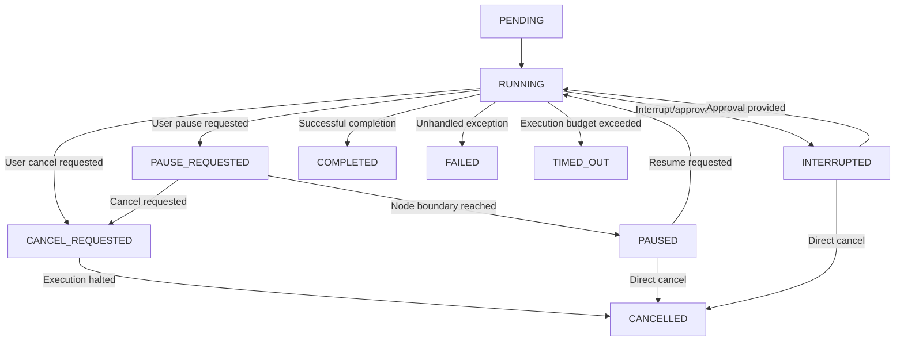

# Execution Visibility & Control — Phase 2 Implementation Plan

Date: 2026-11-17  
Status: Approved Implementation Plan  
Prerequisite: Phase 1 (Thread Locking & Reliability Milestone) ✅ committed (`912e992`)

---

## 1. Overview & Architectural Principles

This phase builds on Base Agent's persistent checkpoints, immutable run graph snapshots, and human-in-the-loop approval pause/resume capabilities. It adds fine-grained execution event logging, state inspection, cooperative pause/cancellation, and durable multi-process recovery.

### Core Architectural Invariants
1. **LangGraph checkpoints remain the execution recovery authority**: Event history is an append-only audit and inspection log. It must never become a competing execution state store.
2. **Cooperative, safe boundaries**: Pause and cancellation are evaluated at node execution boundaries. Cancellation does not attempt to reverse completed external side effects (HTTP calls, database writes).
3. **Strict tenant isolation**: All event queries, state inspection, and control commands enforce `user_id` ownership derived from the authenticated context.
4. **Per-run sequence ordering**: Event ordering uses a monotonically increasing, per-run step counter (`sequence` starting at 1 per `run_id`).
5. **Zero secret leakage**: Redaction filters actively strip API keys, secrets, authorization headers, and signed URL signatures from persisted event summaries.

---

## 2. Increment 1 — Execution History and State Inspection

### Objective
Make every workflow run observable with structured, step-by-step event history, per-invocation tracking, and redacted state inspection.

### 2.1 Database Schema (`workflow_run_events`)
A dedicated append-only table recording granular lifecycle events per run:

```sql
CREATE TABLE workflow_run_events (
    id UUID PRIMARY KEY DEFAULT gen_random_uuid(),
    run_id UUID NOT NULL REFERENCES workflow_runs(id) ON DELETE CASCADE,
    sequence INTEGER NOT NULL,                   -- Monotonically increasing per run (1, 2, 3...)
    invocation_id UUID NOT NULL,                 -- Unique per node visit (differentiates loops & retries)
    node_id VARCHAR(255) NOT NULL,
    node_type VARCHAR(50) NOT NULL,
    attempt INTEGER NOT NULL DEFAULT 1,          -- Retry attempt index
    event_type VARCHAR(50) NOT NULL,             -- node_started | node_completed | node_failed |
                                                 -- tool_called | tool_returned |
                                                 -- model_called | model_returned |
                                                 -- approval_requested | approval_received |
                                                 -- pause_requested | paused |
                                                 -- cancel_requested | cancelled | timed_out
    occurred_at TIMESTAMPTZ NOT NULL DEFAULT now(),
    duration_ms INTEGER,                         -- Execution latency in ms (NULL on started events)
    status VARCHAR(50),                          -- success | failed | NULL
    error_code VARCHAR(100),                     -- Standardized error category
    error_message TEXT,                          -- Redacted, truncated error description
    input_summary JSONB,                         -- Redacted, bounded input payload
    output_summary JSONB,                        -- Redacted, bounded output payload
    model_id VARCHAR(100),                       -- LLM model used (for model events)
    prompt_tokens INTEGER,                       -- Prompt token count (NULL if unavailable)
    completion_tokens INTEGER,                   -- Completion token count (NULL if unavailable)
    tool_name VARCHAR(100),                      -- Tool name (for tool events)
    tool_invocation_id VARCHAR(255),             -- Idempotency key for tool calls
    metadata_json JSONB NOT NULL DEFAULT '{}',   -- Request ID, correlation IDs, extra context
    CONSTRAINT uq_workflow_run_events_run_sequence UNIQUE (run_id, sequence)
);

CREATE INDEX ix_workflow_run_events_run_node ON workflow_run_events (run_id, node_id);
CREATE INDEX ix_workflow_run_events_run_sequence ON workflow_run_events (run_id, sequence);
```

### 2.2 Redaction Rules
Applied automatically before persisting `input_summary`, `output_summary`, and `error_message`:
- **Key Pattern Masking**: Any dictionary key matching `/(api_?key|token|password|secret|auth|credential|signature)/i` has its value replaced with `"[REDACTED]"`.
- **Signed URL Sanitization**: URLs matching `X-Amz-Signature` or presigned credential parameters are replaced with `"[REDACTED_URL]"`.
- **Payload Boundaries**: String values truncated to 500 characters; list/array payloads capped to the first 5 elements with an indicator if truncated.
- **Safe Error Messages**: Database connection strings (`postgresql://...`, `r2://...`) and internal trace paths stripped.

### 2.3 Node Tracing Architecture
- Implement a centralized `trace_node` context manager in `app/services/workflow/tracing.py`.
- At compile time in `app/services/workflow/compiler.py`, wrap node handlers with tracing rather than scattering timing and logging logic across individual node implementations.
- Monotonic sequence generation: Track sequence counter per run within the execution lifecycle to assign `1, 2, 3...` sequentially to each event.
- Token counts extracted from LLM `usage_metadata` where available; recorded explicitly as `null` (never false `0`) when unsupported.

### 2.4 API Additions

| Method | Endpoint | Description |
|---|---|---|
| `GET` | `/api/v1/workflows/runs/{run_id}/events` | Cursor-paginated events (`?after_sequence=X&limit=50`). Returns `items` and `next_cursor`. |
| `GET` | `/api/v1/workflows/runs/{run_id}/state` | Redacted persisted checkpoint state, current active node, pending approval/pause details, and supported actions. |

---

## 3. Increment 2 — Manual Pause/Resume and Cancellation

### Objective
Provide explicit, transactional lifecycle controls to pause execution at safe node boundaries, resume paused runs, and cancel active or paused runs.

### 3.1 Lifecycle State Transitions



### 3.2 State Machine Rules
1. **Node Boundary Checks**: In `trace_node`, check before invoking each node handler whether `control_request` is pending:
   - If `pause_requested`: Trigger LangGraph checkpointing interrupt with reason `manual_pause` and transition run status to `PAUSED`.
   - If `cancel_requested`: Raise a cooperative `WorkflowCancelledError`, record `cancelled` event, set status to `CANCELLED`, and halt execution.
2. **Resume Discrimination**:
   - `resume_workflow_run` handles both `INTERRUPTED` (requires validated approval payload) and `PAUSED` (resumes without payload requirement).
   - Serializes concurrent resume attempts using PostgreSQL row-level locks (`SELECT ... FOR UPDATE` on `workflow_runs`).
3. **Inactive Cancellation**:
   - If run is `PAUSED` or `INTERRUPTED`, `POST /cancel` immediately sets `status = "CANCELLED"` and invalidates pending continuation authority.

### 3.3 API Additions

| Method | Endpoint | Status Code | Description |
|---|---|---|---|
| `POST` | `/api/v1/workflows/runs/{run_id}/pause` | `202 Accepted` | Requests execution to pause at next node boundary. Fails 409 if terminal. |
| `POST` | `/api/v1/workflows/runs/{run_id}/cancel` | `202 Accepted` | Requests cancellation of running workflow or cancels inactive paused run. |
| `POST` | `/api/v1/workflows/runs/{run_id}/resume` | `200 OK` | Resumes paused or interrupted run with concurrency serialization. |

---

## 4. Increment 3 — Durable Execution, Timeouts, and Worker Recovery

### Objective
Ensure workflows survive network disconnects, background worker restarts, and runaway execution loops.

### 4.1 Deliverables
1. **Durable Taskiq Execution**: Dispatch runs through background worker queue (`taskiq-pg`) decoupled from incoming HTTP request lifecycles.
2. **Execution Budget & Timeouts**:
   - Track `budget_seconds` and `consumed_seconds` on `WorkflowRun`.
   - Exclude intentional waiting time (approval pause or manual pause) from the consumed budget.
   - Transition to `TIMED_OUT` when active execution time exceeds budget.
3. **Worker Leases & Heartbeats**:
   - Assign `worker_id` and maintain `lease_expires_at` (renewed every 15s).
   - Detect abandoned or crashed workers via stale lease sweepers; mark orphaned runs `FAILED` without replaying non-idempotent side effects.
4. **Tool Idempotency Keys**:
   - Generate deterministic tool invocation IDs (`{run_id}:{node_id}:{invocation_id}:{attempt}`).
   - Pass as `X-Idempotency-Key` header on HTTP tool executions.

---

## 5. Verification & Completion Gates

### Increment 1
- [ ] Database migration applies cleanly with `workflow_run_events` table and unique constraint on `(run_id, sequence)`.
- [ ] Sequential events emitted for start, end, chat, retrieve, code, and tool nodes.
- [ ] Loop iterations and retries receive distinct `invocation_id` values.
- [ ] Redaction verified: Sensitive keys and signed URLs are never written in plaintext.
- [ ] Cursor pagination advances monotonically via `?after_sequence=`.
- [ ] 100% offline test suite passes without breaking existing run response contracts.

### Increment 2
- [ ] Pause request at node boundary suspends execution to `PAUSED` with checkpoint intact.
- [ ] Resume from `PAUSED` executes next node without re-running completed nodes.
- [ ] Approval resume still strictly enforces approval schemas and deadlines.
- [ ] Concurrency: Two simultaneous resume calls serialize; only one executor enters.
- [ ] Cancel on active run stops at next boundary and records `CANCELLED`.
- [ ] Cancel on `PAUSED`/`INTERRUPTED` run cancels immediately.

### Increment 3
- [ ] Execution budget correctly deducts active runtime while ignoring paused duration.
- [ ] Expired worker lease recovery detects stalled runs and marks them `FAILED`.
- [ ] Disposable PostgreSQL integration tests verify leases, recovery, and timeouts.
